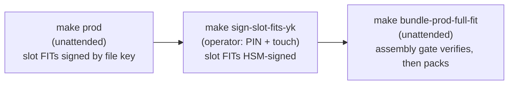

# FIT Image Setup and Signing Guide

This guide covers FIT boot flow setup, manual key generation, and FIT signature verification for the IoT Gateway project.

## Policy: FIT-only, signed-or-fail

FIT signed boot is the **only** supported flow — there is no non-FIT kernel and
no `IOTGW_BOOT_FLOW` toggle. The distro (`iotgw-common.inc`) sets the FIT kernel
provider and signing policy unconditionally, so every build (dev/base/prod/
desktop) is FIT. The `iotgw-fit-signing-guard.bbclass` guard **hard-fails the
build** unless the build-time FIT signing key — the **file key** — is present:

- **File key (required; the in-band signer):**
  `${UBOOT_SIGN_KEYDIR}/${UBOOT_SIGN_KEYNAME}.{crt,key}`. `iotgw-fit-image` always
  signs the FIT with this file key during the build (via the upstream
  `kernel-fit-image` class), so both the cert **and** the private key must exist.
  Generate one below.
- **YubiKey / SoftHSM (trust roots + out-of-band resigner) — NOT build-time
  signers.** Their public certs are injected into the control DTB as trust roots
  (`IOTGW_FIT_TRUST_YK_KEY` / `IOTGW_FIT_TRUST_SOFTHSM_KEY`), and
  `scripts/fit-signing/sign_fit.py` re-signs the FIT with the HSM key *after* the build (the
  detached ceremony). A YubiKey/SoftHSM public cert cannot sign the FIT and does
  not replace the file key.

All key material is operator-generated and gitignored — nothing is shipped. A
clean checkout with no key configured fails the build fast (at u-boot
`do_configure`); metadata inspection (`make parse`, `bitbake -e`) still works.

Set the required file key in `kas/local.yml`:

```yaml
local_conf_header:
  fit_signing: |
    UBOOT_SIGN_KEYDIR  = "${IOTGW_RAUC_KEY_DIR}/fit"
    UBOOT_SIGN_KEYNAME = "iotgw-fit-dev"
```

### Split-FIT model
- `PREFERRED_PROVIDER_virtual/kernel = "linux-iotgw-mainline"` builds the raw
  kernel `Image`; `KERNEL_IMAGETYPE = "Image"` (not flipped to `fitImage`).
- The signed `fitImage` is assembled + signed by the separate `iotgw-fit-image`
  recipe (upstream `kernel-fit-image` class) and is the input to the per-slot
  FITs: `iotgw-verity-image.bbclass` builds `<image>.fitImage-a` / `-b` (kernel +
  DTB whose bootargs carry the slot's dm-verity table) and stages them onto
  `/boot` as `fitImage-a` / `fitImage-b`; the generic `fitImage` is not on `/boot`.
- Boot is the compiled-in U-Boot env (`iotgw_load_boot` / `iotgw_exec_fit`)
  loading per-slot `fitImage-a` / `fitImage-b`. No `boot.scr` (`CONFIG_CMD_SOURCE`
  disabled by `surface_reduce` hardening).

### FIT config model

The FIT carries a single signed `default` configuration (`FIT_CONF_DEFAULT_DTB`),
assembled by the upstream `kernel-fit-image` class (`iotgw-fit-image`). U-Boot boots
that default with a bare `bootm` (no `#conf`); `iotgw_fit_conf` is an operator
override only, cleared by the OTA hook on every install. If multiple board configs
are ever needed, use the upstream class's `FIT_CONF_MAPPINGS`.

## Generate FIT Signing Keys (Manual)
Use a dedicated keypair (do not reuse RAUC or mTLS keys):

```bash
FIT_KEY_DIR="${IOTGW_RAUC_KEY_DIR}/fit"  # or any secure directory
install -d -m 700 "$FIT_KEY_DIR"
openssl genrsa -out "$FIT_KEY_DIR/iotgw-fit-dev.key" 2048
openssl req -new -x509 \
  -key "$FIT_KEY_DIR/iotgw-fit-dev.key" \
  -out "$FIT_KEY_DIR/iotgw-fit-dev.crt" \
  -days 3650 \
  -subj "/CN=iotgw-fit-dev/O=IoT Gateway Dev/OU=FIT Signing"
chmod 600 "$FIT_KEY_DIR/iotgw-fit-dev.key"
chmod 644 "$FIT_KEY_DIR/iotgw-fit-dev.crt"
```

## Enable FIT Signing in Local Config
Point the `fit_signing` block in `kas/local.yml` (shown above) at the key
directory. `IOTGW_FIT_SIGNING`, `UBOOT_SIGN_ENABLE`, `FIT_HASH_ALG`/`FIT_SIGN_ALG`
and `FIT_GENERATE_KEYS` are set by the distro (`iotgw-common.inc`); only the
operator key path and name live in `kas/local.yml`.

Notes:
- Key management is manual (`FIT_GENERATE_KEYS = "0"`, set by the distro).
- This project currently validates FIT signing/verification with RSA.
- ECDSA path is not validated in this repository yet; do not treat it as a
  supported/verified production path.

## Ensure U-Boot Supports FIT Signature Verification
This project enables required U-Boot options via:
- `meta-iot-gateway/recipes-bsp/u-boot/files/iotgw-uboot.cfg`

Relevant options include:
- `CONFIG_FIT=y`
- `CONFIG_FIT_SIGNATURE=y`
- `CONFIG_RSA=y`
- `CONFIG_RSA_PUBLIC_KEY_PARSER=y`
- `CONFIG_SHA256=y`

## Build Signed FIT Bundle
Force rebuild of U-Boot and kernel artifacts after signing changes:

```bash
. scripts/env.sh && kas shell kas/local.yml -c 'bitbake -c cleansstate u-boot virtual/kernel'
make bundle-dev-full-fit
```

## Verify Signed FIT on Host
Check the structure of a slot FIT (the files U-Boot boots):

```bash
dumpimage -l build/tmp/deploy/images/raspberrypi5/iot-gw-image-dev-raspberrypi5.rootfs.fitImage-a
```

Expected:
- kernel and FDT entries present
- hash nodes present (sha256)
- signature-related fields present when signing is enabled


Runtime config selection: the FIT carries only its single signed `default`
configuration, so `iotgw_fit_conf` must stay **unset** — U-Boot boots the
default with a bare `bootm` (no `#conf`). There is no alternate config to
select; setting `iotgw_fit_conf` to any name would fail `bootm` and burn the
slot's boot attempts. The OTA bundle hook clears the variable on every install
so a stale value cannot persist:

```bash
fw_printenv iotgw_fit_conf          # expect: not defined
```

Verify the bundle payload carries both slot FITs and the bootfiles archive.
Bundles are `crypt` by default, so extract with RAUC rather than an archive
tool:

```bash
OUT=$(mktemp -d)/bundle
rauc extract --trust-environment \
  --keyring=/path/to/root-ca-primary.crt \
  --key=/path/to/device-decryption.key \
  build/tmp/deploy/images/raspberrypi5/iot-gw-image-dev-bundle-full-fit.raucb "$OUT"
ls "$OUT"/*.fitImage-a "$OUT"/*.fitImage-b
tar -tzf "$OUT/bootfiles-fit.tar.gz" | grep u-boot.bin
```

## Install and Verify on Target
Install bundle and reboot:

```bash
iotgw-rauc-install <url>/iot-gw-image-dev-bundle-full-fit.raucb
reboot
```

Validate boot mode. The boot flow is the compiled-in U-Boot environment (there
is no `boot.scr`), so inspect `u-boot.bin` and the per-slot FIT files:

```bash
strings /boot/u-boot.bin | grep -E "iotgw_load_boot|iotgw_exec_fit"
ls -l /boot/fitImage-a /boot/fitImage-b
rauc status
```

Expected:
- `iotgw_load_boot=...` selects the per-slot file (`fitImage-a` / `fitImage-b`) by `${rauc_slot}`; there is no fallback (a missing slot FIT zeroes that slot's boot attempts and resets).
- `iotgw_exec_fit=... bootm ...` boots the FIT's signed default config.
- `fitImage-a` and `fitImage-b` are both present from the flashed image; an OTA rewrites the one for the slot it installs.

Check U-Boot log for verification path:
- FIT configuration selected
- hash verification success lines
- no `Bad Data Hash` / `Unsupported hash algorithm`

## Negative Test (Tamper Protection)
Goal: confirm tampered FIT does not boot.

Suggested method, on the booted slot's FIT (`/boot/fitImage-a` when booted
from slot A; `rauc status` shows the booted slot):
1. Back up the FIT on target.
2. Modify one byte in it.
3. Reboot and confirm U-Boot verification failure.
4. Restore the backup and reboot.

Example for slot A (careful, test device only):

```bash
cp /boot/fitImage-a /boot/fitImage-a.bak
printf '\x00' | dd of=/boot/fitImage-a bs=1 seek=4096 count=1 conv=notrunc
sync
reboot
```

A failed verification zeroes that slot's boot attempts, so the device falls
back to the other slot; restore the backup from there.

Expected failure symptoms in U-Boot log:
- hash/signature verification error
- kernel not booted

## Production Notes
- Use separate production FIT signing keys.
- Keep production private keys offline/HSM-managed.
- Do not commit keys into repository.
- Keep RAUC signing keys and FIT signing keys separate.

## Signing tooling

FIT signing is driven by `scripts/fit-signing/sign_fit.py`; the Make targets
and operator runbooks call it directly.

### Subcommands

```bash
uv run python scripts/fit-signing/sign_fit.py sign-fit       --profile NAME --fit PATH     [--verify] [--rewrite-only]
uv run python scripts/fit-signing/sign_fit.py sign-bootfiles --profile NAME --archive PATH [--force]  [--verify]
uv run python scripts/fit-signing/sign_fit.py sign-slot-fits --profile NAME --image NAME --deploy-dir DIR --archive PATH [--force]
uv run python scripts/fit-signing/sign_fit.py verify         --fit PATH --dtb PATH         [--fit-check-sign-path PATH]
uv run python scripts/fit-signing/sign_fit.py print-profile  --profile NAME                [--profile-config PATH]
```

`sign-fit`, `sign-bootfiles` and `sign-slot-fits` invoke
`mkimage -F -N pkcs11 -k <profile.uri>` under the hood; `verify` calls
`fit_check_sign` against a supplied DTB for a real RSA signature check
(distinct from the structural `--verify` flag, which only inspects
audit metadata).

### Signing profiles

Each profile bundles the FIT key-name-hint, the PKCS#11 lookup URI, and
the OpenSSL engine_pkcs11 config. Profiles may also carry an
operator-facing `signer_alias` for audit output, and an optional
`pkcs11_module` path used only by the preflight check. Defaults ship in
`scripts/fit-signing/fit-signing-profiles.yml` (YAML is used here for consistency
with the kas overlay files):

```yaml
fit_signing_profiles:
  yubikey-9a:
    key_name_hint: "iotgw-fit-yk-2027"
    uri: "pkcs11:object=Private%20key%20for%20PIV%20Authentication"
    engine_conf: "keys/dev/yk/openssl-engine.cnf"
    signer_alias: "YK-PRIMARY"

  softhsm-dev:
    key_name_hint: "iotgw-fit-softhsm-dev"
    uri: "pkcs11:object=iotgw-fit-softhsm-dev"
    engine_conf: "keys/dev/softhsm/fit/openssl-engine.cnf"
    signer_alias: "SOFTHSM-DEV"
```

Override the config file path with `--profile-config <path>` or the
`IOTGW_FIT_SIGNING_PROFILES` environment variable. Individual fields
can be overridden with `--key-name-hint`, `--uri`, `--engine-conf`,
`--signer-alias`, and `--pkcs11-module`.
`--print-profile` resolves a profile (with overrides applied) and
prints it without signing — useful for diagnostics.

For release/audit runs, pass `--provenance <path>` to write a redacted
JSON signing-result document. Inline PKCS#11 PIN material such as
`pin-value=...` is replaced before it reaches the JSON. Pass
`--pkcs11-preflight --pkcs11-module <module.so>` when you want the tool
to enumerate the token with `pkcs11-tool --list-slots` before mutating
the FIT/archive; module paths are host-specific, so they are normally
kept in operator-local profile files rather than committed defaults.

PyYAML is the only Python runtime dependency, and it is resolved through
the repo's uv-managed environment rather than the host Python package set.

### Reproducible Python environment

The operator signing CLI and the test suite use a
[uv](https://docs.astral.sh/uv/)-managed Python environment so PyYAML
and pytest versions are pinned via `uv.lock`. Yocto/BitBake builds do
not depend on uv, but the host-side signing ceremony does.

```bash
# One-time setup (Ubuntu 24.04 — uv ships via apt; see uv docs for
# other distros or the official install method).
sudo apt install uv

# Sync the venv (.venv at the repo root, gitignored). Run after a
# fresh clone or after bumping pyproject.toml / uv.lock.
make tools-venv

# Operator signing targets enter this environment via `uv run`.
make sign-slot-fits-yk
make sign-slot-fits-softhsm

# Run the test suite. SoftHSM tests skip cleanly when no SoftHSM
# token is on the host.
make test-sign-fit

# Run the full suite including SoftHSM integration tests. Requires
# `softhsm2` + `libengine-pkcs11-openssl` on the host.
make test-sign-fit-softhsm
```

### Make targets

| Target | Profile | When to use |
|--------|---------|-------------|
| `make sign-slot-fits-yk` | `yubikey-9a` | Release flow: re-signs an image's dm-verity slot FITs (`SLOT_FITS_IMAGE=`, default `iot-gw-image-prod`). Requires a YubiKey with slot 9a provisioned. Prompts for PIN, requires touch. |
| `make sign-slot-fits-softhsm` | `softhsm-dev` | Dev flow for engineers without a YubiKey. Requires the SoftHSM dev key provisioned (see below). |
| `make sign-bootfiles-fit-yk` / `-softhsm` | as above | Re-sign the generic `fitImage` inside `bootfiles-fit.tar.gz`. No install hook boots that FIT, so this does not make a bundle bootable under a different trust root. |

The slot-FIT targets accept `SIGN_SLOT_FITS_ARGS`; the bootfiles targets accept
`SIGN_BOOTFILES_ARGS` and `SIGN_FIT_ARGS`. Example:

```bash
make sign-slot-fits-yk SLOT_FITS_IMAGE=iot-gw-image-dev SIGN_SLOT_FITS_ARGS=--force
```

### SoftHSM dev provisioning (one-time, dev-only)

SoftHSM is a software PKCS#11 token — keys live on disk, not in
hardware. It enables YubiKey-free dev signing for engineers without
hardware tokens. **Never use SoftHSM-signed artifacts on production
images**; the corresponding DTB trust gate
(`IOTGW_FIT_TRUST_SOFTHSM_KEY`) is dev-only.

The distro `softhsm2` package (Debian/Ubuntu/Fedora 2.6.x) is
sufficient. Engineers building SoftHSM 2.7.0 locally point the
operator tooling at it by editing the `MODULE_PATH` line in the
profile's engine config file (`keys/dev/softhsm/fit/openssl-engine.cnf`
in the default profile). `sign_fit.py` consumes the path indirectly
via OpenSSL's engine_pkcs11 — there is no Python-side env var that
overrides it.

(`IOTGW_SOFTHSM_MODULE` is consulted only by the pytest suite in
`scripts/fit-signing/tests/conftest.py` for SoftHSM module discovery when
running tests against a non-distro build. It does not affect the
operator-facing `sign_fit.py`.)

Initial provisioning:

```bash
# 1. Isolated token store under the operator vault.
SOFTHSM_BASE="$PWD/keys/dev/softhsm"   # repo root; gitignored
install -d -m 700 "$SOFTHSM_BASE/tokens" "$SOFTHSM_BASE/fit"
cat > "$SOFTHSM_BASE/softhsm2.conf" <<EOF
directories.tokendir = $SOFTHSM_BASE/tokens
objectstore.backend = file
EOF
export SOFTHSM2_CONF="$SOFTHSM_BASE/softhsm2.conf"

# Locate the distro module (Debian/Ubuntu path; adjust for other distros).
SOFTHSM_MOD=/usr/lib/softhsm/libsofthsm2.so

# 2. Init a token.
softhsm2-util --module "$SOFTHSM_MOD" --init-token --free \
    --label iotgw-fit-dev --pin 1234 --so-pin 123456

# 3. Generate the dev signing keypair on the token.
pkcs11-tool --module "$SOFTHSM_MOD" --token-label iotgw-fit-dev \
    --login --pin 1234 \
    --keypairgen --key-type rsa:2048 \
    --label iotgw-fit-softhsm-dev --id 01

# 4. OpenSSL engine_pkcs11 config.
cat > "$SOFTHSM_BASE/fit/openssl-engine.cnf" <<EOF
openssl_conf = openssl_init

[openssl_init]
engines = engine_section

[engine_section]
pkcs11 = pkcs11_section

[pkcs11_section]
engine_id = pkcs11
dynamic_path = /usr/lib/x86_64-linux-gnu/engines-3/pkcs11.so
MODULE_PATH = $SOFTHSM_MOD
init = 0
EOF

# 5. Self-sign a cert against the on-token key (no private key on disk).
OPENSSL_CONF="$SOFTHSM_BASE/fit/openssl-engine.cnf" \
openssl req -new -x509 \
    -engine pkcs11 -keyform engine \
    -key "pkcs11:object=iotgw-fit-softhsm-dev;type=private;pin-value=1234" \
    -days 3650 \
    -subj "/CN=iotgw-fit-softhsm-dev/O=iotgw-dev" \
    -out "$SOFTHSM_BASE/fit/iotgw-fit-softhsm-dev.crt"
```

The SoftHSM Make targets default `SOFTHSM2_CONF` to
`keys/dev/softhsm/softhsm2.conf`; an exported `SOFTHSM2_CONF` overrides it.

The default profile expects the engine config at
`keys/dev/softhsm/fit/openssl-engine.cnf` (repo-relative, gitignored) and the
cert at `keys/dev/softhsm/fit/iotgw-fit-softhsm-dev.crt`. To use a
different layout, copy `scripts/fit-signing/fit-signing-profiles.yml` to a vault
location, edit the SoftHSM profile, and export
`IOTGW_FIT_SIGNING_PROFILES=<path>`.

## DTB trust rotation: file key → YubiKey

The U-Boot **control FDT** (the runtime DTB the RPi firmware passes to
U-Boot) holds the public keys U-Boot trusts when verifying FIT
signatures at boot. Rotating from a file-key-only trust root to a
hardware-resident YubiKey pubkey is the second leg of FIT-signing
adoption: post-build HSM signing produces FITs that only verify on devices
whose control FDT carries the corresponding pubkey.

This project ships a three-stage rotation pattern modelled after the
RAUC PKI rotation (see `docs/RAUC_PKI.md`), plus an optional dev variant
that adds a SoftHSM-resident trust root for engineers without a
YubiKey:

| Stage | DTB trust roots | FIT signing key | Notes |
|-------|-----------------|-----------------|-------|
| File-key only | file key only | file key | Single in-band trust root. |
| **Rotation window** | **file key + YK pubkey** | file key (build) or YK (post-build, optional) | DTB carries both pubkeys with `/signature/required-mode = "any"`. A FIT signed by either root verifies. |
| Production cutover | YK pubkey only | YK (post-build, mandatory) | File key retired via the `kas/fit-release-trust.yml` release overlay (`IOTGW_FIT_TRUST_FILE_KEY = "0"`; SoftHSM forced off too). |
| Dev variant (optional) | adds SoftHSM dev pubkey alongside any of the above | YK (production) or SoftHSM (dev) | `IOTGW_FIT_TRUST_SOFTHSM_KEY = "1"`. **Dev hardware only — never ship.** |

The rotation-window build is the only one that should ship while
operators still hold the legacy file-key private material. Devices
that boot it will accept any future YK-signed FIT, so the rotation can
proceed without re-flashing.

The Dev variant is a dev-loop tool: enable
`IOTGW_FIT_TRUST_SOFTHSM_KEY` alongside the YK gate to build an image
that boots either a real YK-signed FIT or a SoftHSM-signed FIT — useful
for shared dev hardware between YK-equipped and YK-less engineers.
No production build should carry the SoftHSM trust gate — devices in
the field must trust only YubiKey-backed roots.

### Operator pre-flight: export the YK public certificate

The build host needs the public certificate from slot 9a. **No private
key is exported, ever.** Capture once into the operator key tree:

```bash
KEY_DIR="${IOTGW_RAUC_KEY_DIR}/rauc-ca/fit"
install -d -m 700 "$KEY_DIR"
ykman piv certificates export 9a "$KEY_DIR/iotgw-fit-yk-2027.crt"
chmod 644 "$KEY_DIR/iotgw-fit-yk-2027.crt"
openssl x509 -in "$KEY_DIR/iotgw-fit-yk-2027.crt" -noout -subject -dates
```

The certificate filename is `<IOTGW_FIT_YK_KEYNAME>.crt`; renaming the
YubiKey hint string in the project requires renaming this file in
lockstep. The default `iotgw-fit-yk-2027` is intentionally year-tagged
so a future rotation lands at `iotgw-fit-yk-<NEW_YEAR>` without
clobbering existing trust anchors on already-deployed rotation-window
devices.

### Build-time configuration (rotation window)

In `kas/local.yml`, enable both trust roots:

```yaml
local_conf_header:
  fit_dtb_yk_pubkey_trust: |
    IOTGW_FIT_TRUST_FILE_KEY = "1"
    IOTGW_FIT_TRUST_YK_KEY = "1"
    IOTGW_FIT_YK_KEYDIR = "${IOTGW_RAUC_KEY_DIR}/rauc-ca/fit"
    IOTGW_FIT_YK_KEYNAME = "iotgw-fit-yk-2027"
```

Force rebuild of the kernel so the deploy step re-mutates the DTBs:

```bash
. scripts/env.sh && kas shell kas/local.yml -c 'bitbake -c cleansstate virtual/kernel'
make bundle-dev-full-fit
```

The kernel recipe's (`linux-iotgw-mainline_6.18.bb`) `do_deploy:append` block:

- Loops over `RPI_KERNEL_DEVICETREE` DTBs.
- When `IOTGW_FIT_TRUST_FILE_KEY = "1"`: runs `fdt_add_pubkey` to inject
  the file-key public key into the DTB under
  `/signature/key-<UBOOT_SIGN_KEYNAME>`. (The FIT itself is signed by
  `iotgw-fit-image`, and the per-slot FITs by `iotgw-verity-image.bbclass`.)
- When `IOTGW_FIT_TRUST_YK_KEY = "1"`: runs
  `fdt_add_pubkey -a ${FIT_HASH_ALG},${FIT_SIGN_ALG} -k <yk-keydir> -n <yk-keyname> -r conf`
  to add a second key node under `/signature/key-<IOTGW_FIT_YK_KEYNAME>`
  (no private key required).
- When `IOTGW_FIT_TRUST_SOFTHSM_KEY = "1"`: same shape as the YK
  injection but using `<softhsm-keydir>` and `<softhsm-keyname>`. Dev
  builds only.
- Counts how many of the three trust gates are enabled. If more than
  one, sets `/signature/required-mode = "any"` via `fdtput` so a FIT
  signed by any one root verifies. With exactly one trust root,
  `required-mode` is left unset — U-Boot's default semantics handle the
  single-required-key case.

All three gates off with `UBOOT_SIGN_ENABLE=1` is fatal — the recipe
refuses to deploy unsigned-trust DTBs.

### Verifying the DTB build output

Inspect the deployed DTB:

```bash
DTB=build/tmp/deploy/images/raspberrypi5/bcm2712-rpi-5-b.dtb
fdtget -l "$DTB" /signature
fdtget    "$DTB" /signature required-mode
```

Expected output:

```
key-iotgw-fit-dev
key-iotgw-fit-yk-2027
any
```

Both `key-*` subnodes present, `required-mode = "any"`. If
`required-mode` is missing or set to `"all"` and both keys are
`required = "conf"`, a FIT signed by only one key will be rejected at
boot.

`fdtget -l` is preferred over `fdtdump | sed` because the latter can
silently truncate at the first `};` and hide a second key node.

### On-target verification

After flashing a rotation-window build and booting:

```bash
# Confirm both trust roots are live in U-Boot's control FDT.
cat /sys/firmware/devicetree/base/signature/required-mode
ls /sys/firmware/devicetree/base/signature/
```

Expected: `any` on stdout, and two `key-*` directories.

Test both signing paths sequentially:

1. **File-key-signed FIT path** — flash the rotation-window build,
   boot, check U-Boot log for FIT verification success against
   `key-${UBOOT_SIGN_KEYNAME}`. Normal `iotgw-rauc-install` flow works
   as it did pre-rotation.
2. **YK-signed FIT path** — run
   `make sign-slot-fits-yk SLOT_FITS_IMAGE=iot-gw-image-dev` against the
   same build to re-sign both slot FITs with slot 9a, reassemble the bundle
   (`make bundle-dev-full-fit`), install on the device that booted step 1,
   reboot. U-Boot must accept the FIT against
   `key-iotgw-fit-yk-2027`.

Both paths must boot cleanly on the same device before promoting the
rotation-window build to fleet rollout, and before scoping the
production cutover.

### Production cutover

The cutover build sets `IOTGW_FIT_TRUST_FILE_KEY = "0"` and
`IOTGW_FIT_TRUST_SOFTHSM_KEY = "0"` via the committed
`kas/fit-release-trust.yml` overlay (see the next section). The recipe
then injects only the YK pubkey, and with a single trust root
`required-mode` is left unset — U-Boot's default single-required-key
verification applies. The bundle FIT MUST be HSM-signed before release; a
file-key-signed FIT would be rejected by every fielded device.

## Release vs dev KAS trust profiles

Two profiles govern which trust roots land in the U-Boot control FDT.

| Profile | `IOTGW_FIT_TRUST_FILE_KEY` | DTB trust roots | `required-mode` |
|---------|---------------------------|-----------------|-----------------|
| **Dev** (default) | `1` | file key + YubiKey/SoftHSM pubkey(s) | `any` (multi-root) |
| **Release** | `0` | YubiKey pubkey only | unset (single root) |

The release profile also forces `IOTGW_FIT_TRUST_SOFTHSM_KEY = "0"`,
so a developer's `kas/local.yml` with all three trust roots enabled cannot
leak the SoftHSM dev key into a release DTB.

### Dev profile

The default. `IOTGW_FIT_TRUST_FILE_KEY` defaults to `"1"` in the
distro (`iotgw-common.inc`), so no kas overlay change is needed for dev builds. The dev
profile is the multi-root rotation-window configuration where a FIT
signed by any enabled trust root verifies at boot.

### Release profile

`kas/fit-release-trust.yml` is a committed overlay that sets
`IOTGW_FIT_TRUST_FILE_KEY = "0"` and
`IOTGW_FIT_TRUST_SOFTHSM_KEY = "0"` — the file key and the
dev-only SoftHSM key are both dropped, leaving the YubiKey pubkey as the
sole trust root. Forcing SoftHSM off matters because a developer's
`kas/local.yml` may enable all three roots; without it a release build
composed on that config would carry the SoftHSM dev key in the DTB. The
overlay uses bare assignments. It is composed automatically with `prod` and
`bundle-prod-full-fit` by the `Makefile` whenever
the file exists (the same pattern as `kas/uboot-prod-hardening.yml`), and
after `kas/local.yml` so it wins by parse order. A release
build therefore picks up the release trust profile without any manual
`kas/local.yml` change.

Safety gate: with `IOTGW_FIT_TRUST_FILE_KEY = "0"`, if
`IOTGW_FIT_TRUST_YK_KEY` is also not `"1"`, the recipe `bbfatal`s at
`do_deploy` time. `iotgw-uboot-prod-key-guard.bbclass` enforces the same
invariant earlier and independently: it fails any prod build
(`iot-gw-image-prod` / `appliance_lockdown`) whose trust gates are not
the release set — file and SoftHSM off, YubiKey on — before
`do_configure`. Release builds require a YubiKey trust root. Ensure
`kas/local.yml` (or another composed overlay) sets:

```yaml
local_conf_header:
  fit_dtb_yk_pubkey_trust: |
    IOTGW_FIT_TRUST_YK_KEY = "1"
    IOTGW_FIT_YK_KEYDIR = "${IOTGW_RAUC_KEY_DIR}/rauc-ca/fit"
    IOTGW_FIT_YK_KEYNAME = "iotgw-fit-yk-2027"
```

Verifying the release DTB output:

```bash
DTB=build/tmp/deploy/images/raspberrypi5/bcm2712-rpi-5-b.dtb
fdtget -l "$DTB" /signature       # exactly one subnode: key-iotgw-fit-yk-2027
fdtget -p "$DTB" /signature       # property list must NOT include required-mode
```

With a single trust root the recipe leaves `required-mode` unset, so
`fdtget "$DTB" /signature required-mode` errors with "not found" — that
absence is the expected result, not a failure.

### Supported release artifacts under the release profile

Under the release profile, `make prod` does **not** produce a final
flashable SD image. The `.wic.zst` it deposits in `${DEPLOY_DIR_IMAGE}`
contains `/boot/fitImage-a` / `fitImage-b` that are still **file-key
signed** at build time — the DTB on the same image only trusts the
YubiKey root, so flashing that WIC fails U-Boot FIT verification on the
first boot cycle and exhausts both RAUC slots.

With runtime dm-verity, what U-Boot boots is a per-slot FIT,
`<image>.fitImage-a` / `-b`: its device tree carries that slot's
dm-verity table, and the bundle's OTA install hook (`bundle-hooks-fit.sh`)
writes the one matching the slot it installs as `/boot/fitImage-a` or
`-b`. The generic `fitImage` inside `bootfiles-fit.tar.gz` is not installed
by that hook, so re-signing it (`make sign-bootfiles-fit-yk`) does **not**
make a release bundle bootable. The slot FITs have to be re-signed:
`make sign-slot-fits-yk` (see
[Runtime dm-verity: signing the slot FITs](#runtime-dm-verity-signing-the-slot-fits)).
Neither target touches the FITs baked into the WIC's boot partition.

The supported release artifact is therefore the **RAUC bundle assembled
from YubiKey-signed slot FITs**:

```bash
make prod                            # stage 1: image; slot FITs are file-key signed intermediates
make sign-slot-fits-yk               # stage 2: YK + PIN + touch per FIT; re-signs both slot FITs
make bundle-prod-full-fit            # stage 3: assembly gate verifies the staged FITs, then packs
```

Running `make bundle-prod-full-fit` before stage 2 fails at the assembly
gate by design: it refuses to pack slot FITs that do not verify against the
release anchor the bundle ships.

The output `iot-gw-image-prod-bundle-full-fit.raucb` is the deliverable
for field rollout — install it on a device that was previously
provisioned (initial flash via a dev or dual-trust SD image, then moved
to release trust in stages). Signed production initial-flash SD images are
not currently part of the supported flow. An OTA never replaces the trust
anchor, and nothing accepts an anchor that would strand a slot, so the move
is staged:

1. OTA the release bundle. The device's pre-install handler accepts it only
   when the current (dual-trust) anchor already trusts the YubiKey key that
   signed its slot FITs.
2. OTA it again, so the other slot also carries a YubiKey-signed FIT.
3. Run `iotgw-rpi-bootfiles-update` from the release image to install its
   YubiKey-only DTB. It refuses while either installed slot FIT is still
   signed only with the file key, because that slot would no longer boot.

Any other order is refused before anything is written.

The `iotgw-rauc-image.bbclass` carries a parse-time anonymous Python
guard that emits a `bb.warn` whenever a WIC-producing image recipe is
parsed under release-trust (i.e. `IMAGE_FSTYPES` contains a `wic`
variant, `IOTGW_FIT_TRUST_FILE_KEY="0"`, and `IOTGW_FIT_TRUST_YK_KEY="1"`).
The check runs at every `bitbake` invocation against an affected image
recipe — including sstate-covered rebuilds where task prefuncs would be
bypassed. The warning names the unbootable artifact and points at this
workflow; it is loud-by-design. If you have suppressed it locally,
you've also taken on responsibility for not flashing the resulting
`.wic.zst`.

## Signing FIT against a PKCS#11 token (YubiKey)

The default flow above signs the FIT inside bitbake against a file-based
RSA key under `UBOOT_SIGN_KEYDIR`. The HSM-backed flow moves the FIT
signing key to a PKCS#11 token (the YubiKey PIV slot 9a in this
repository's example, RSA-2048) and performs the signing as a
**post-build** step. The bitbake-side signer stays file-based; only the
deploy artifact is re-signed.

### Why not sign inside bitbake

> **Note.** The signer uses the OpenSSL `engine_pkcs11` path and requires a
> proper `pkcs11:object=…` URI — a bare filesystem keydir gets only a "Legacy
> URI" warning + `pkcs11:` prepend, not a valid HSM URI. The primary reason for
> detached signing is version-independent: a YubiKey PIN+touch cannot sit on an
> unattended build's critical path.

mkimage 2025.04's `-N pkcs11` code path has three behaviours that
together make in-bitbake PKCS#11 signing unworkable and constrain even
post-build wrapper use (unchanged in u-boot 2026.01):

1. **`-G` is ignored entirely.** `lib/rsa/rsa-sign.c`'s
   `rsa_engine_get_priv_key()` never references `params.keyfile`
   inside the pkcs11 branch. The URI mkimage actually uses is built
   from `-k` (`keydir`) and the FIT's `key-name-hint` (`name`), never
   from `-G`.
2. **`-k <bare-keydir-path>` is malformed.** When `keydir` does not
   contain `object=`, mkimage synthesises
   `pkcs11:<keydir>;object=<hint>;type=private` — a non-RFC-7512 URI
   that `engine_pkcs11` rejects. The upstream `kernel-fit-image.bbclass`
   FIT signing (`FIT_KERNEL_SIGN_KEYDIR`) uses a bare filesystem keydir,
   hitting this case.
3. **`-k <URI-containing-object=>` is the only working form.** mkimage
   takes the `keydir` verbatim and appends `;type=private`, producing
   a clean RFC-7512 URI. `scripts/fit-signing/sign_fit.py` uses this form with the
   default URI pointing to libykcs11's hardcoded slot 9a label
   (`Private key for PIV Authentication`).

There is also a silent no-op trap: `mkimage -F -N pkcs11 <fit>`
without `-k` exits 0, regenerates hashes, repacks the FDT, and leaves
the original signature bytes untouched. `sign_fit.py`
guards against this by requiring at least one `Signature written` line
in mkimage's captured output before declaring success.

Upstream note: the meta-oe `fitimage.bbclass` available on wrynose
provides native PKCS#11 FIT signing support. This project deliberately
keeps the post-build `sign_fit.py` flow instead — HSM keys and operator
PIN/touch never enter the bitbake build environment.

### How `scripts/fit-signing/sign_fit.py sign-fit` works

`scripts/fit-signing/sign_fit.py sign-fit` does three
things, in order:

1. **`fdtput` rewrite** — walks every
   `/configurations/conf-*/signature*/key-name-hint` and sets it to the
   project-controlled hint (default `iotgw-fit-yk-2027`, override with
   `--key-name-hint`). This hint must match the
   `/signature/key-<hint>` node injected into U-Boot's control FDT by
   the kernel recipe (`linux-iotgw-mainline`) — devices reject FITs whose hint doesn't
   resolve to a trusted key. It also drives the resulting `Sign algo:`
   audit line. It is **not** the key-lookup mechanism for signing.
2. **`mkimage -F -N pkcs11 -k "<uri>" <fit>`** — signs in place via
   `engine_pkcs11` against `libykcs11`. **mkimage 2025.04 ignores
   `-G` entirely in its `-N pkcs11` code path** (`lib/rsa/rsa-sign.c`
   does not reference `params.keyfile` for the pkcs11 engine), and the
   `-k` path only uses the URI verbatim when it already contains
   `object=`. For any other URI form (`id=`, `token=` without
   `object=`), mkimage rewrites it as
   `pkcs11:<keydir>;object=<key-name-hint>;type=private` — broken
   unless the FIT hint happens to equal a real libykcs11 object label.
   The default URI is therefore object-anchored to libykcs11's
   hardcoded slot 9a label:
   `pkcs11:object=Private%20key%20for%20PIV%20Authentication`.
   Slot-anchored URIs (`pkcs11:id=%01;type=private`) require a signer
   that calls OpenSSL directly rather than through mkimage's
   `-N pkcs11` path. PIN is prompted on the terminal; touch is
   required per slot 9a's touch policy (`CACHED` covers a multi-config
   signing call with one tap).
3. **Success detection + structural verify** — captures mkimage's
   output; requires at least one `Signature written` log line.
   Deterministic RSA-PKCS#1 v1.5 over the FIT signed range makes
   byte-comparison guards unreliable (re-signing the same content
   with the same key produces identical bytes), so the log line is
   the authoritative success signal. The optional `--verify` is a
   *structural* check on top: it asserts every signature node
   carries `Sign algo: sha256,rsa2048:<KEY_NAME_HINT>` and a non-empty
   `Sign value`. It does **not** cryptographically verify the
   signature against the slot's public key — for that, run
   `mkimage -V` against a DTB that embeds the expected pubkey.

The script mutates `--fit` in place. Run it against a copy of the
deploy artifact:

```bash
cp build/tmp/.../fitImage /tmp/fit-test/fitImage.yk
uv run python scripts/fit-signing/sign_fit.py sign-fit --profile yubikey-9a --fit /tmp/fit-test/fitImage.yk --verify
```

### What success looks like

On the serial console, a healthy verified boot under the multi-trust-root
control DTB (`required-mode=any`) prints one `error!` line per non-matching
trust root before the matching key verifies — this is expected, not a
failure:

```
   Using 'conf-bcm2712-rpi-5-b.dtb' configuration
   Verifying Hash Integrity ... sha256,rsa2048:iotgw-fit-dev-  error!
Verification failed for '<NULL>' hash node in 'conf-bcm2712-rpi-5-b.dtb' config node
sha256,rsa2048:iotgw-fit-dev-  error!
Verification failed for '<NULL>' hash node in 'conf-bcm2712-rpi-5-b.dtb' config node
sha256,rsa2048:iotgw-fit-dev+ OK
```

U-Boot tries the FIT's signature against every required key in the control
DTB (file / YubiKey / SoftHSM) until one matches; `required-mode=any` needs
exactly one `+ OK`. Only an output ending with **no** `+ OK` line (followed
by the slot being marked non-bootable) is an actual verification failure.

On a YubiKey-signed FIT, `dumpimage -l` shows, for every
configuration:

```
Sign algo:    sha256,rsa2048:iotgw-fit-yk-2027
Sign value:   <256 bytes of fresh RSA-2048 signature>
Timestamp:    <signing time, not build time>
```

Compared against the file-signed source, the configurations'
`Sign value` bytes are entirely different and the `Timestamp` is the
post-build signing wall clock. Both keys produce 256-byte RSA-2048
signatures over the same hash, so byte-length is identical — only the
content differs.

For release evidence, capture `dumpimage -l` output and SHA-256 hashes
for the source and HSM-signed FIT artifacts in the release record.

For bundle-side evidence, extract the final `.raucb` with RAUC itself
instead of raw `unsquashfs` (encrypted `crypt` bundles are not directly
readable as SquashFS):

```bash
DEPLOY=build/tmp/deploy/images/raspberrypi5
OUT=/tmp/iotgw-fit-bundle-check

rm -rf "$OUT"
rauc extract \
  --trust-environment \
  --keyring=/path/to/root-ca-primary.crt \
  --key=/path/to/device-decryption.key \
  "$DEPLOY/iot-gw-image-dev-bundle-full-fit.raucb" \
  "$OUT"

for f in "$OUT"/*.fitImage-a "$OUT"/*.fitImage-b; do
  dumpimage -l "$f" | grep -E 'Sign algo:|Sign value:|Timestamp:'
done
```

### Runtime dm-verity: signing the slot FITs

HSM signing must never sit on the critical path of an unattended build. The
signing step is a separate ceremony — run on a machine with the HSM
physically attached, by an operator who is present, or by a hardened signing
daemon — and its output is fed back into a final assembly step. The three
stages below are independent Make targets; none is a prerequisite of another.

The image builds two per-slot FITs, `<image>.fitImage-a` and `-b`, each
binding the kernel to a device tree whose command line holds that slot's
dm-verity table and `rauc.slot=`. Those are what the bundle installs and
U-Boot boots, and what the stages sign:



1. **Build** (`make prod`, unattended). The slot FITs are signed with the
   build's file key. Under the release profile the shipped anchor does not
   trust that key, so the FITs are intermediates: `iotgw-fit-gate` checks
   them against an anchor holding only the build key (signature present,
   kernel and fdt covered, intact), not against the release anchor they
   cannot yet pass.
2. **Sign** (`make sign-slot-fits-yk`, operator-only; `-softhsm` for dev).
   Runs `sign_fit.py sign-slot-fits` on the image's pair, never on a glob
   of the deploy directory (`SLOT_FITS_IMAGE`, default `iot-gw-image-prod`).
   Before asking for the PIN it checks that the pair belongs together:
   single-configuration FITs, slot identity, a `dm-mod.create` table equal
   to the one the image recipe generates (read the way the kernel parses
   the command line), and `veritysetup` verifying the rootfs file against
   it. It then signs A and B. The PIN is asked once per FIT, because each
   `mkimage` run opens its own PKCS#11 session, and a touch is needed per
   FIT. It confirms each command line came through byte-identical and
   that each FIT verifies against an anchor holding only the signing key.
   Both FITs are backed up before either is signed; any failure restores
   both. A FIT is skipped only if it already carries the profile's key
   **and** verifies against that key alone. A manifest
   `<image>.slot-fits.signed` records the result.
3. **Assemble** (`make bundle-prod-full-fit`, unattended). The bundle
   recipe tracks both slot FITs, the verity parameters and the bootfiles
   archive by content, so re-signed FITs re-run assembly. The assembly gate
   (`iotgw-bundle-slot-gate.bbclass`) then runs on the files staged into
   the bundle, not on deploy copies. The trust anchor is the DTB inside the
   staged bootfiles archive, which must hold exactly the build's enabled
   trust roots. Both staged FITs must verify against it, and the slot
   checks above are repeated against the staged rootfs. Any failure stops
   the bundle; the gate never signs.

The checks live in `meta-iot-gateway/scripts/slot_fits.py`, shared by the
operator tool and the bundle recipe. `slot_fits.py check` runs them alone.
Dev and dual-trust bundles pass the same gate with no stage 2, because
their anchor also trusts the file key.

### CI / signing-server integration

For pipelines that have to be fully unattended, the only options are:

1. **Detached signing server** — a small daemon on a controlled host
   with the HSM permanently attached. It receives a signing request
   (artifact + metadata) over an authenticated channel (mTLS), runs
   the equivalent of the sign phase, returns the signed artifact.
   The PIN is pre-loaded into the daemon's session at start-up
   (operator authenticates once); touch can be CACHED with a long
   window or NEVER (lower-assurance only). The CI runner then runs
   the assemble phase.
2. **Manual handoff** — CI runs the build phase and publishes
   artifacts; a release manager pulls them to a workstation with the
   token attached, runs the sign phase, publishes the signed slot FITs
   back; a final CI job (or the operator) runs the assemble phase.

The repository ships only the building blocks (`scripts/fit-signing/sign_fit.py`
and the sign/assemble Make targets: `sign-slot-fits-*`, `bundle-*-full-fit`). The signing daemon
is intentionally out of scope here — it belongs to whichever signing
infrastructure consumes this layer.

The example token policy in this repository is touch `CACHED` + PIN
`ALWAYS`, which prevents headless unattended HSM signing unless a
project explicitly chooses a relaxed signing-server policy.

### Slot 9a provisioning reference

Provision slot 9a with an RSA-2048 private key generated on-device,
create or import the matching public certificate used for U-Boot FIT
verification, and capture the YubiKey F9 attestation certificate in the
release key-management record. Private-key material must never be
exported or committed. Local engine/provider configuration and
certificates are expected to live outside the repository, for example
under an operator-controlled key directory.
